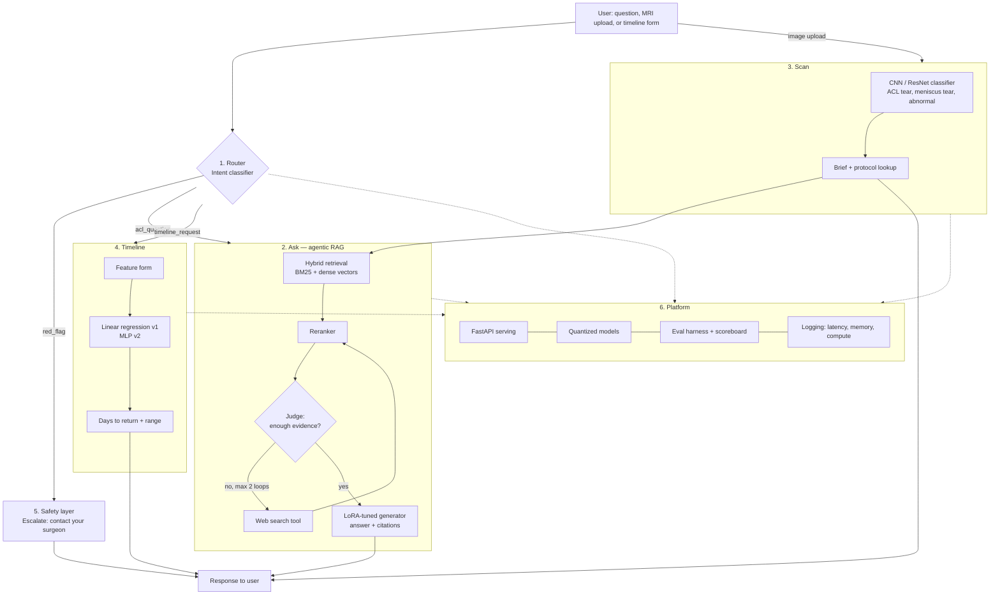

# Tensa — V1 Build Plan

> An open-source, ML-centric tool for ACL patients. Every model is written from scratch first (NumPy), then rebuilt in PyTorch, then fine-tuned, quantized, served and measured.
> Goal of V1: build it end to end, understand why every piece goes where it goes, and publish the numbers — including what broke.

---

## 1. Vision

Tensa answers three things for someone dealing with a knee injury or ACL surgery:

1. **Ask** — "What should I be able to do at week 6?" → a grounded, cited answer.
2. **Scan** — upload an MRI slice → likely injury (ACL tear / meniscus tear / abnormal) + what to expect and which post-op protocol applies.
3. **Timeline** — enter your situation → estimated days to return to sport, with a range.

Everything sits behind an **intent router** and a **safety layer**, and runs on a **platform** that serves the models and records every metric.

**V1 is not a medical device.** All outputs are educational, cited, and escalate red flags to a clinician.

---

## 2. Final product — system view



---

## 3. Subsystems

### 3.1 Router — intent classifier
**Job:** read every text prompt and send it to the right pipeline.

| Item | Detail |
|---|---|
| Classes | `acl_question`, `timeline_request`, `red_flag`, `off_topic` (image uploads are routed by file type, not the classifier) |
| v1 (NumPy) | Logistic regression on TF-IDF features — softmax, cross-entropy, gradient descent written by hand |
| v2 (PyTorch) | Fine-tuned small encoder (MiniLM or DistilBERT) |
| Data | MedQuAD questions + LLM-generated examples per class; hand-check ~200 for the test set |
| Metrics | Macro-F1, **red_flag recall** (most important — never miss one), latency |

### 3.2 Ask — agentic RAG
**Job:** answer ACL questions from evidence, and go find more when evidence is thin.

**Flow:** query → hybrid retrieval → rerank → judge → (web search loop, max 2) → generate with citations.

| Component | From scratch | Then | Metric |
|---|---|---|---|
| Keyword search | BM25 in NumPy | — | nDCG@10, recall@k |
| Dense search | Cosine similarity + top-k in NumPy | Fine-tuned embedder (sentence-transformers), stored in pgvector | nDCG@10 vs BM25 |
| Hybrid | Score fusion (e.g. reciprocal rank fusion) by hand | — | nDCG@10 vs each alone |
| Reranker | — | Cross-encoder fine-tune | nDCG@10 gain |
| Judge | — | Small classifier or LLM-as-judge: "is this enough to answer?" | Agreement with ~100 hand labels |
| Web tool | — | Search API call + same reranker on results | % of queries that needed it |
| Generator | — | LoRA fine-tune of a 1–3B open instruct model (e.g. Qwen2.5-1.5B, Llama-3.2-1B) | Faithfulness, citation accuracy vs base model and vs Gemini |

**Data:** BEIR biomedical sets (NFCorpus, SciFact, TREC-COVID) to train and benchmark; ACL papers from the PubMed Central Open Access subset as the real corpus; MedQuAD for generator fine-tuning.

### 3.3 Scan — MRI classifier
**Job:** given an MRI, estimate the injury and hand off to Ask for the protocol brief.

| Item | Detail |
|---|---|
| v1 | Small CNN written in PyTorch from basic layers (conv, ReLU, pool, linear) |
| v2 | Pretrained ResNet-18 with transfer learning; compare against v1 |
| Labels | ACL tear, meniscus tear, abnormal (MRNet's labels — no MCL, MRI only, no X-ray) |
| Data | MRNet (1,370 knee MRI exams, Stanford) |
| Metrics | AUC per label, sensitivity/specificity, latency, model size |
| Note | Split by patient — never let the same patient appear in train and test |

### 3.4 Timeline — recovery estimator
**Job:** estimate days to return to sport from patient features.

| Item | Detail |
|---|---|
| Features | Age, sex, graft type (patellar tendon / hamstring / quad), meniscus repair (y/n), revision (y/n), pre-injury activity level, BMI, rehab adherence |
| Data | **Simulated cohort** — write a generator whose effects are based on published findings, plus noise. Clearly labelled as simulated. |
| v1 (NumPy) | Linear regression with gradient descent (write the parameter updates yourself) |
| v2 (PyTorch) | MLP: Linear → ReLU → Linear → ReLU → Linear (single output) |
| Metrics | MAE in days, prediction interval coverage |
| Bonus | Because you wrote the generator, you know the true function — you can check whether each model actually recovers it |

### 3.5 Safety layer
- Red-flag intent skips every pipeline → "Contact your surgeon or go to emergency care."
- Every Scan result says "educational, not a diagnosis."
- Ask refuses when the judge finds no evidence after 2 loops — no uncited answers.
- Log every red-flag trigger for review.

### 3.6 Platform — serving, quantization, measurement
| Item | Detail |
|---|---|
| Serving | FastAPI backend, one endpoint per subsystem; existing Next.js frontend calls it |
| Quantization | int8 dynamic quantization for classifier, CNN, MLP (PyTorch); 4-bit GGUF for the generator served through Ollama |
| Tracking | Weights & Biases or MLflow for every training run |
| Eval harness | One command re-runs every benchmark and updates the scoreboard |

---

## 4. Data sources

| Dataset | Used for | Ready? |
|---|---|---|
| BEIR biomedical (NFCorpus, SciFact, TREC-COVID) | Retrieval training + benchmarks | Yes — `pip install beir` or Hugging Face |
| PubMed Central Open Access subset | ACL corpus for Ask | Yes — download + chunk |
| MedQuAD (~47k NIH Q&A pairs) | Generator fine-tune, intent examples | Yes |
| MRNet | Scan classifier | Yes — free registration with Stanford AIMI |
| Simulated cohort | Timeline | You generate it |
| Hand-checked labels | Intent test set, judge labels, ~50 ACL retrieval queries | You make these — small and fast |

---

## 5. Build order (matches the prep path)

Your starting point: logistic regression (theory, never implemented), linear regression (never with gradient-descent updates), CNN and ResNet (concepts only), LoRA / from-scratch work (new).

| Stage | Build | What you learn |
|---|---|---|
| **0. Setup** | Repo, environments, eval harness skeleton, scoreboard table | Project structure, reproducibility |
| **1. NumPy** | Linear regression + GD (Timeline v1) → logistic regression (Router v1) → BM25 + cosine search (Ask) | Gradients, loss functions, vectorization, ranking metrics |
| **2. PyTorch basics** | Port linear/logistic → MLP (Timeline v2) | Tensors, autograd, training loops, `nn.Module` |
| **3. Vision** | Small CNN → ResNet-18 transfer (Scan) | Convolutions, data loaders, augmentation, transfer learning |
| **4. Retrieval** | Embedder fine-tune → hybrid fusion → reranker | Contrastive learning, hybrid search, nDCG |
| **5. LLMs** | Encoder fine-tune (Router v2) → LoRA generator → judge + web loop | PEFT/LoRA, agent loops, faithfulness eval |
| **6. Production** | Quantize everything, serve with FastAPI, load-test | Quantization tradeoffs, latency, memory, compute |
| **7. Publish** | Open-source repo + scoreboard + write-up of what broke | Communicating results |

**Working rule with Claude Code:** ask it to explain the next piece and give you a skeleton with `TODO`s. You write the math and the training loop yourself. Ask it to review, not to write.

---

## 6. Scoreboard (fill in as you go)

| Model | Version | Params | Train time | GPU hrs | Quality metric | Score | p50 latency | p95 latency | Memory | Score after quant |
|---|---|---|---|---|---|---|---|---|---|---|
| Router | NumPy logreg | | | | Macro-F1 | | | | | |
| Router | MiniLM | | | | Macro-F1 | | | | | |
| Retrieval | BM25 | — | — | — | nDCG@10 | | | | | |
| Retrieval | Dense | | | | nDCG@10 | | | | | |
| Retrieval | Hybrid + rerank | | | | nDCG@10 | | | | | |
| Judge | | | | | Agreement % | | | | | |
| Generator | Base | | — | — | Faithfulness | | | | | |
| Generator | LoRA | | | | Faithfulness | | | | | |
| Scan | CNN | | | | AUC (ACL) | | | | | |
| Scan | ResNet-18 | | | | AUC (ACL) | | | | | |
| Timeline | NumPy linear | | | | MAE (days) | | | | | |
| Timeline | MLP | | | | MAE (days) | | | | | |

---

## 7. How you know something broke (debug playbook)

Run these every time you build a model. Log the results in the repo — the failures are part of the write-up.

1. **Gradient check (NumPy stage):** compare your hand-written gradient to a numerical one (finite differences). If they differ, the math is wrong.
2. **Overfit one batch:** train on ~10 examples. Loss should go to near zero. If it doesn't, the bug is in the model or training loop, not the data.
3. **Beat a dumb baseline:** majority class (Router), mean prediction (Timeline), BM25 (Retrieval). If you can't beat it, something is broken.
4. **Watch the curves:** training loss falling but validation loss rising = overfitting. Loss = NaN = learning rate too high or bad inputs. Flat loss = learning rate too low, dead ReLUs, or labels misaligned.
5. **Shape and value asserts:** assert tensor shapes and value ranges at every step. Most early bugs are shape bugs.
6. **Leakage checks:** patient-level splits for MRNet; no test queries in training data for retrieval.
7. **Look at real outputs:** read 20 predictions by hand after every run. Metrics can look fine while outputs are nonsense.
8. **Regression tests on eval:** if a change drops a scoreboard number, find out why before moving on.
9. **Quantization check:** compare quantized vs full-precision outputs on the same inputs, not just the final metric.

---

## 8. Repo structure

```
tensa/
├── data/                 # gitignored; download scripts only
├── ml/
│   ├── scratch/          # NumPy: linreg.py, logreg.py, bm25.py, cosine.py
│   ├── router/
│   ├── retrieval/        # embedder, hybrid, reranker
│   ├── judge/
│   ├── generator/        # LoRA fine-tune
│   ├── scan/             # cnn.py, resnet.py
│   └── timeline/         # simulator.py, mlp.py
├── eval/                 # harness + scoreboard.md
├── serving/              # FastAPI app
├── web/                  # Next.js frontend
└── docs/                 # this plan, debug log, write-ups
```

---

## 9. Compute

- Free tiers (Google Colab, Kaggle) are enough for everything in V1.
- Heaviest jobs: ResNet on MRNet and the LoRA fine-tune — use 4-bit loading (QLoRA) to fit on a free GPU.
- Log GPU type, hours and peak memory for every run so the scoreboard has a compute column.

---

## 10. V2 ideas (after V1 ships)

- **Recovery plan generator:** a week-by-week exercise and milestone plan built from physio protocols, personalized by Timeline features.
- Exercise library with progression rules.
- Real user feedback logs → retrain the reranker and router.

---

## 11. References

**Foundations (NumPy stage)**
- Andrew Ng, Machine Learning Specialization (Coursera) — linear and logistic regression, gradient descent
- Stanford CS229 lecture notes — https://cs229.stanford.edu
- Andrej Karpathy, Neural Networks: Zero to Hero — https://karpathy.ai/zero-to-hero.html
- Karpathy, "A Recipe for Training Neural Networks" (debugging) — https://karpathy.github.io/2019/04/25/recipe/

**PyTorch and CNNs**
- PyTorch tutorials — https://pytorch.org/tutorials
- Dive into Deep Learning (CNN and ResNet chapters) — https://d2l.ai
- He et al., "Deep Residual Learning for Image Recognition" (ResNet) — https://arxiv.org/abs/1512.03385
- MRNet dataset and paper — https://stanfordmlgroup.github.io/competitions/mrnet

**Retrieval**
- Okapi BM25 — https://en.wikipedia.org/wiki/Okapi_BM25
- Sentence-Transformers docs (embedders, cross-encoders) — https://sbert.net
- BEIR benchmark — https://github.com/beir-cellar/beir and https://arxiv.org/abs/2104.08663
- Corrective RAG (judge + web search loop) — https://arxiv.org/abs/2401.15884

**LLM fine-tuning and evaluation**
- Hu et al., "LoRA" — https://arxiv.org/abs/2106.09685
- Dettmers et al., "QLoRA" — https://arxiv.org/abs/2305.14314
- Hugging Face PEFT docs — https://huggingface.co/docs/peft
- RAGAS (faithfulness metrics) — https://docs.ragas.io
- MedQuAD — https://github.com/abachaa/MedQuAD

**Production**
- PyTorch quantization docs — https://pytorch.org/docs/stable/quantization.html
- FastAPI docs — https://fastapi.tiangolo.com
- Made With ML (testing, MLOps) — https://madewithml.com
- Google, "Rules of Machine Learning" — https://developers.google.com/machine-learning/guides/rules-of-ml
- Chip Huyen, *Designing Machine Learning Systems* (O'Reilly)

**Data**
- PubMed Central Open Access subset — https://www.ncbi.nlm.nih.gov/pmc/tools/openftlist/
